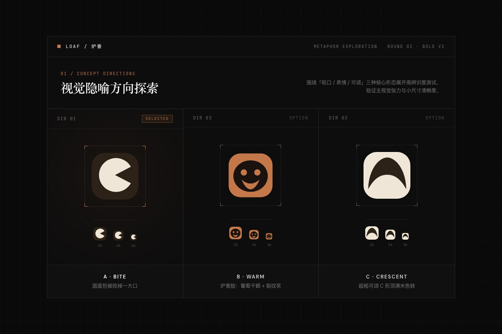
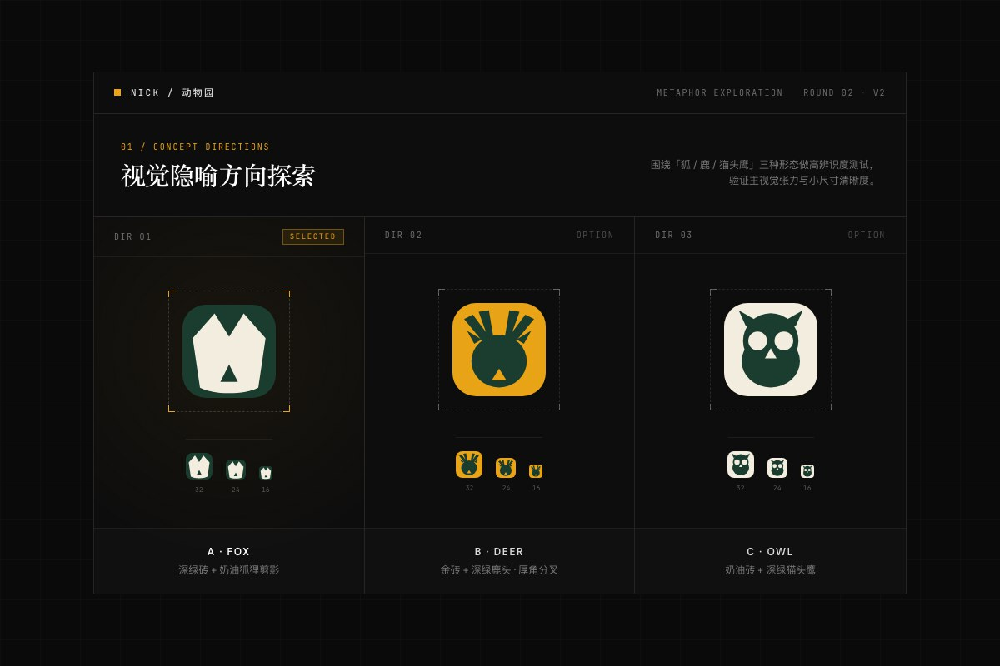
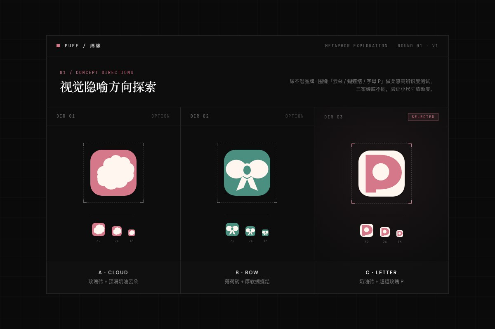
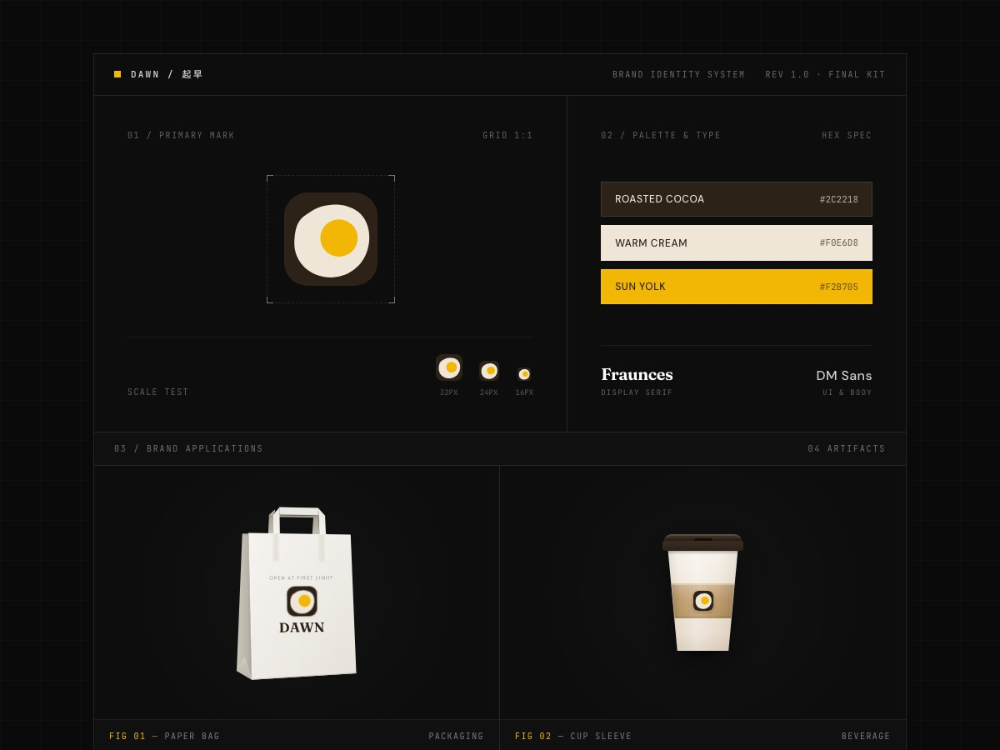
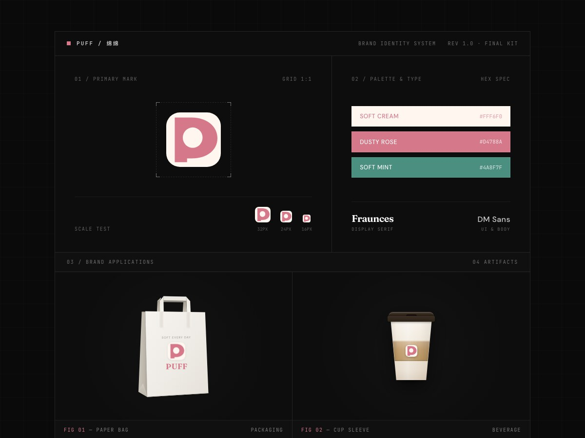
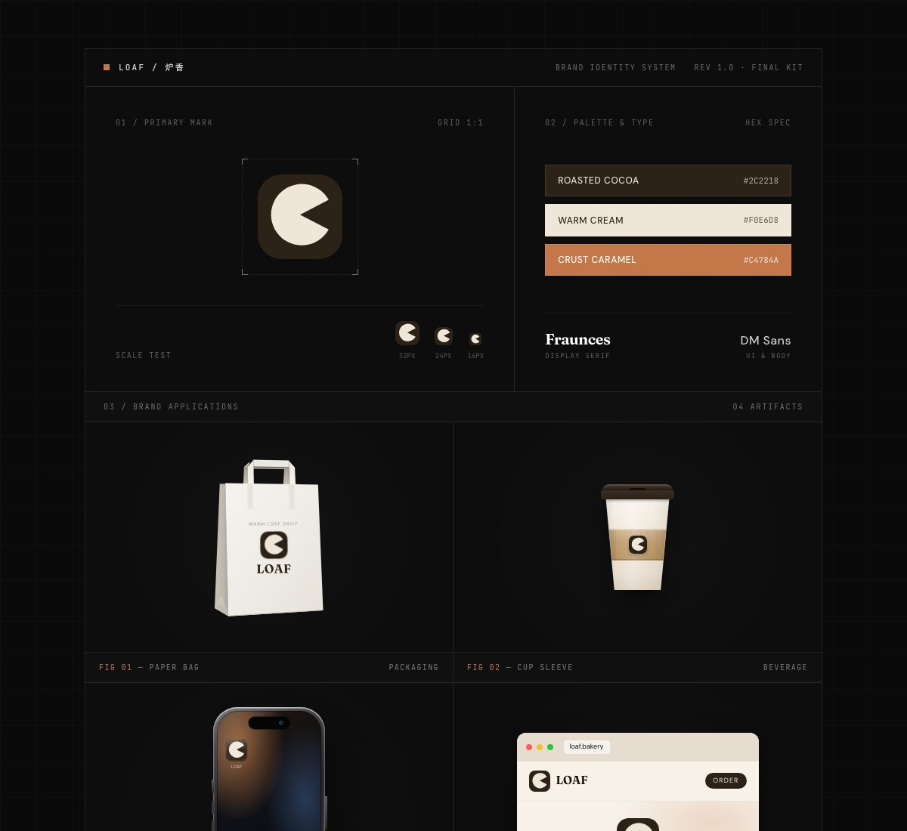

# logo-svg

Cursor Agent Skill for **bold hand-written SVG logos** — not AI image gen.

短说明、真文件、清晰选型。主交付是矢量 `.svg`；选型页 + 可选 Brand Identity Spec 终稿 kit。

## Install

```bash
# Cursor user skills
git clone https://github.com/joekind/logo-svg.git ~/.cursor/skills/logo-svg

# or project-local
git clone https://github.com/joekind/logo-svg.git .cursor/skills/logo-svg
```

## Trigger

`/logo-svg` · logo · 标志 · 商标 · app icon · favicon · 小程序图标

---

## Examples

### Metaphor Exploration Spec

三案对比、准星框主标、`32 / 24 / 16` 小尺寸标尺，选方向后再打磨。

| LOAF · 炉香 | NICK · 动物园 |
|:---:|:---:|
|  |  |

| PUFF · 绵绵 |
|:---:|
|  |

### Brand Identity Spec

定稿后的规范壳：主标 + 色卡字标 + 袋 / 杯 / 手机 / 网站应用。

| DAWN · 起早 | PUFF · 绵绵 |
|:---:|:---:|
|  |  |

| LOAF · applications |
|:---:|
|  |

---

## Workflow

1. Brief + 模式（`product-icon` / `identity`）+ 主色  
2. 换隐喻 → 留 2～3 案  
3. 手写 SVG → 渲染读图改  
4. **Metaphor Exploration Spec** 选型  
5. （可选）**Brand Identity Spec** 终稿 kit  

## Contents

| File | Role |
|---|---|
| `SKILL.md` | 审美硬杠、工作流、选型页 / 终稿约定 |
| `reference.md` | 细节与检查清单 |
| `assets/blank-bag.svg` | 终稿袋 mockup 源稿（内联进 HTML） |
| `docs/` | README 示例截图 |

## License

MIT
